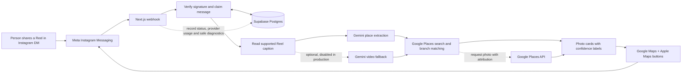

<div align="center">


# MapThat

**Turn places in Instagram Reels into useful map links.**

An independent, work-in-progress project exploring caption extraction, place matching, and a clean Instagram DM experience.

[Instagram @mapthat.app](https://www.instagram.com/mapthatapp/) · [Roadmap](https://github.com/MartinJanus/mapthat/issues)

</div>

> **Status: Work in progress.** The Instagram bot is deployed and the caption-to-place-card flow has been tested. Matching accuracy, safe beta limits, privacy controls, job recovery, and the destination discovery website are still being developed. Results can be uncertain; check a suggested place before travelling.

## What it does

Send a Reel to MapThat in an Instagram DM. For supported messages, the bot extracts place mentions, searches Google Places for candidate venues, and replies with a photo card and direct **Google Maps** and **Apple Maps** buttons. When a match is uncertain, the result is labelled as a possible or likely match.

The current flow is caption-first. An optional Gemini video fallback exists in the code but is disabled in the deployed environment. The bot does not promise to identify every Reel or every venue branch correctly.

## How it works



See [Architecture](docs/architecture.md) for the boundaries, data flow, and current limitations.

## Technology

- **Next.js App Router, React, TypeScript** — webhook endpoint and application foundation.
- **Instagram Messaging API** — receives shared Reel messages and sends replies.
- **Gemini** — extracts place mentions from supported captions; optional video fallback is behind a feature flag.
- **Google Places API (New)** — finds candidate venues and supplies place photos.
- **Supabase Postgres** — stores request identity, extracted place references, provider usage, and allowlisted diagnostic events.
- **Railway** — hosts the current application.
- **Vitest, ESLint, Prettier, GitHub Actions** — tests and automated checks.

## Development

### Requirements

- Node.js **24.21.0** (see `.nvmrc`)
- npm

### Run locally

```bash
git clone https://github.com/MartinJanus/mapthat.git
cd mapthat
nvm install
nvm use
npm ci
npm run dev
```

Open [http://localhost:3000](http://localhost:3000). The homepage and automated tests work without provider credentials. To test the Instagram integration locally, configure the server-side variables described in [`.env.example`](.env.example) in an ignored `.env.local` file and configure a Meta webhook that can reach your local server over HTTPS. Never commit real credentials.

### Checks

```bash
npm run check
```

This runs formatting, lint, TypeScript, tests, and a production build. Tests use fixtures and do not call paid providers.

## Data and privacy notes

Supabase request tracking is server-side. It stores pseudonymous request references, extracted mentions and selected Place IDs, usage metadata, and a bounded set of allowlisted events. It does not store Google photos or copy Google listing content into the database. See [Supabase tracking](docs/supabase-tracking.md).

**Current limitation:** the development Reel-capture helper is invoked by the webhook by default and can write raw webhook payloads, including media URLs, to local ignored files. Do not enable this bot for broad use until capture is disabled by default and retention/deletion behavior is addressed. Follow [issue #19](https://github.com/MartinJanus/mapthat/issues/19).

## Current limitations and next steps

- Match quality needs evaluation against a manually checked set of Reels, including branch ambiguity and multilingual names.
- Processing currently runs during the webhook request. A durable queue, restart recovery, and delivery-aware retries are not implemented.
- Usage limits and an emergency pause are not yet implemented.
- There is no admin dashboard, public discovery site, or external extraction API yet.
- Reel media access depends on the data Meta supplies and the permissions available to the app; unsupported or inaccessible media can’t be assumed to work.
- The project has no license yet. Public code visibility alone does not grant permission to reuse it.

The active roadmap starts with [usage limits](https://github.com/MartinJanus/mapthat/issues/18), [privacy and retention](https://github.com/MartinJanus/mapthat/issues/19), [matching accuracy](https://github.com/MartinJanus/mapthat/issues/20), and a [representative Reel benchmark](https://github.com/MartinJanus/mapthat/issues/21). See [all open issues](https://github.com/MartinJanus/mapthat/issues).

## Project notes

This project is being built incrementally, with small issues, automated tests, CI, and documented trade-offs. The code and backlog reflect a prototype in active development; contributions and feedback are welcome, but setup still requires Meta, Google, Gemini, and Supabase accounts for a full live integration.
