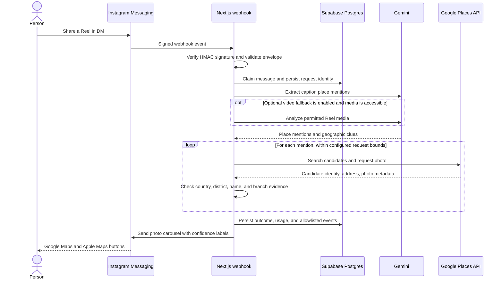

# MapThat architecture

MapThat turns an Instagram Reel shared in a direct message into place cards with Google Maps and Apple Maps links. This document describes the current prototype, including boundaries that still need stronger production reliability.

## Request flow

## Responsibilities

- **Instagram adapter** validates webhook signatures, parses message events, manages message deduplication, and formats/sends Instagram replies.
- **Extraction** asks Gemini for grounded place mentions and geographic context. Provider output is validated before it enters matching.
- **Place matching** searches Google Places and evaluates candidate names, country, district, street, and branch evidence. Possible matches remain visibly uncertain.
- **Tracking** stores request state, place references, provider usage, and allowlisted events in Supabase. Provider listing content and photos are not copied into the database.
- **Entrypoint** is a Next.js App Router webhook, deployed to Railway.

The main code is under `src/features/`; HTTP routing is under `src/app/api/`. Database changes are recorded in `supabase/migrations/`.

## Current reliability boundaries

- Extraction and replies currently run inside the webhook request. A durable queue, stale-job recovery, and delivery-aware retry are planned.
- Supabase claims prevent duplicate message processing across restarts, but a crash after claiming can leave a request in `processing`.
- A local file cache can reuse caption extraction results on the same running deployment; there is no shared Supabase extraction cache yet.
- Optional video fallback is implemented, but disabled in production. A Reel URL alone does not mean its media is available to process.
- Raw webhook capture is currently invoked by default and may persist raw payloads locally. Disable it before broader beta use and define retention/deletion; see [issue #19](https://github.com/MartinJanus/mapthat/issues/19).
- Provider failures, uncertain matches, and missing token/cost metadata are tracked distinctly where available. A full operator dashboard and enforced usage limits are still planned.

## Next system steps

See the prioritized [GitHub issues](https://github.com/MartinJanus/mapthat/issues) for usage limits, capture/privacy controls, accuracy evaluation, shared caching, background jobs, and an admin dashboard.
